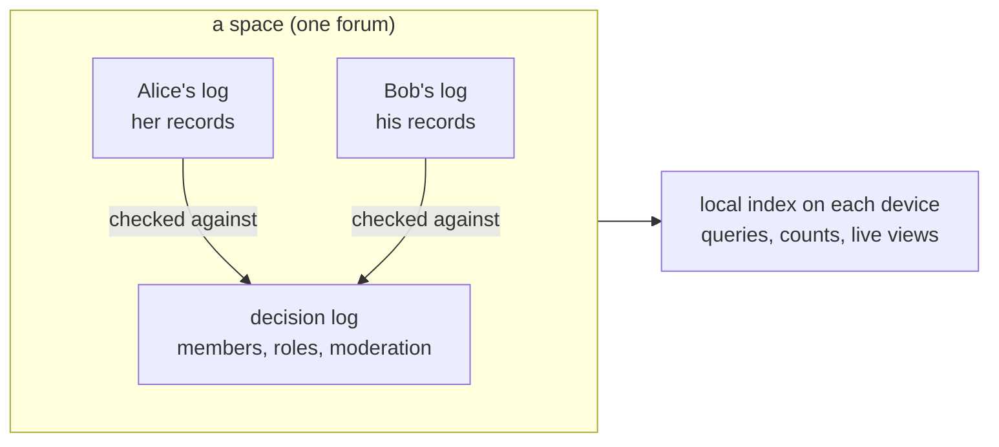

# Hypergraph

> **Alpha.** Breaking changes are expected.

Hypergraph is a JavaScript library for building social apps with no server: forums, chats, wikis,
shared folders, sites. You describe your data, then write and read it. Members, roles, moderation,
invites, several devices per person, private spaces and storage limits come with it, and you don't
need to know replication, cryptography or networking.

Everything lives on the users' own devices and syncs peer to peer, over the
[Holepunch](https://holepunch.to) stack (Hypercore, Autobase, Hyperswarm, HyperDB). It runs on Node
and on Bare (Pear).

## Core ideas

- **Space**: one forum, chat, wiki or folder. It has members, their roles, its rules and its
  content. Its key is its address; members find each other on the network by it.
- **Record**: a piece of content (a post, a comment, a vote, a page) of a type your app declares.
  Each member's device writes its records into a log of its own; edits and deletes are new
  entries, and the latest allowed one wins on every device.
- **Members and roles**: `owner`, `admin`, `moderator`, `member`, `guest`, plus roles your app
  defines. Roles, bans and moderation are decisions in the space's decision log, applied in the
  same order by everyone. **Readers enforce**: every device checks every record against the
  space's rules, so a modified app can't post where it may not.
- **Private spaces**: readable only by their members. Content is encrypted with a key that
  changes when someone leaves, so removed people can't read what comes next. A private top space
  is also encrypted on disk.
- **Circles**: small groups of invited people whose devices keep each other's spaces online
  while their owners are offline. **Helpers** (always-on blind peers) can do the same for a space.



## Example

```js
const { Hypergraph } = require('hypergraph/next')

const hg = await Hypergraph.open('./data', {
  types: {
    post: { fields: { title: 'string', text: 'text' } },
    comment: { fields: { text: 'text', on: 'link' }, links: { on: ['post', 'comment'] } },
    vote: { fields: { value: 'int', on: 'link' }, links: { on: ['post', 'comment'] }, onePerMember: true }
  }
})
await hg.connectToSwarm()

const forum = await hg.createSpace({ name: 'My forum' })      // or: await hg.redeemInvite(link)
const post = await forum.put('post', { title: 'Hello', text: 'First!' })
await forum.put('comment', { on: post, text: 'Welcome' })

const { items, complete } = await forum.query('post').latest(20)   // reads answer at once
forum.on('change', () => { /* read again */ })

const link = await forum.createInvite({ role: 'member' })    // send it any way you like
```

A whole forum in under 400 lines, played by tests: [`test/next/forum/forum.js`](test/next/forum/forum.js).

## Quick start

Not published to npm yet. Clone it next to your project and depend on it by path:

```json
"dependencies": { "hypergraph": "file:../hypergraph" }
```

`npm install` links your project to the checkout, so changes to hypergraph are live without a
reinstall. (npm 12 refuses `github:` dependencies unless its `allow-git` setting allows them.)

To work on hypergraph itself:

```bash
npm install
```

```bash
npm run test:next
```

```bash
npm run test:next:bare
```

`test:next` runs the core's tests on Node, `test:next:bare` on Bare. More in
[CONTRIBUTING.md](CONTRIBUTING.md).

## Documentation

- [Concepts](docs/next/concepts.md): how spaces, records, decisions, devices and storage work.
- [API](docs/next/api.md): every call, with examples.
- **API reference**: `npm run docs` generates it into `out/api/` from the JSDoc in `lib/`.
- [All docs](docs/README.md), [roadmap](ROADMAP.md).
- **The inspector**: `node tools/inspector/demo.js` plays a three-member forum, each member with a
  read-only web page of what it holds ([tools/inspector/README.md](tools/inspector/README.md)).

## Types

`lib/` is plain JavaScript typed with JSDoc and checked by TypeScript in strict mode (`npm run typecheck`),
with nothing to compile. Editors (VS Code and others) read those types: completion, hover docs and
errors as you type, in JavaScript too. TypeScript users get `.d.ts` files for `hypergraph/next` and
`hypergraph/testing`, built by `npm run types` (into `dist/types/`, on `npm pack`). They need no setup: Node's types
(`@types/node`) come with them as a dependency.

## The old version

`src/` is v1 (`require('hypergraph')`), a graph store with contexts. It is frozen, kept only until
its last user moves to the new core, and will be removed. Don't start anything new on it; its docs
are in [docs/v1/](docs/v1/).

## License

MIT
